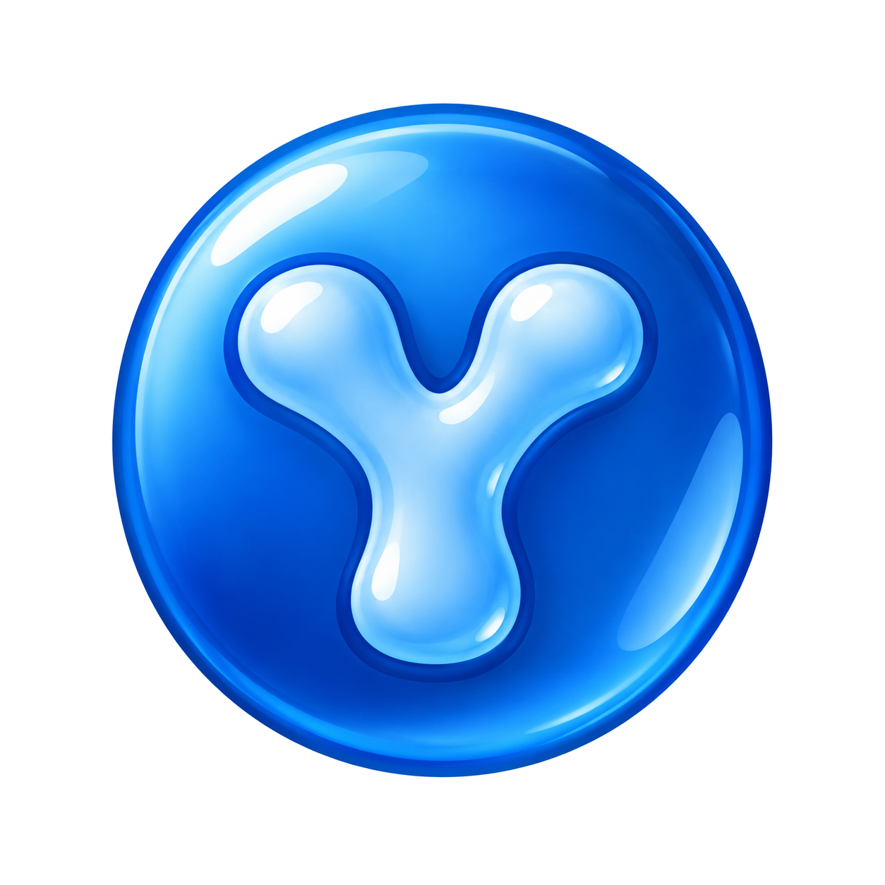
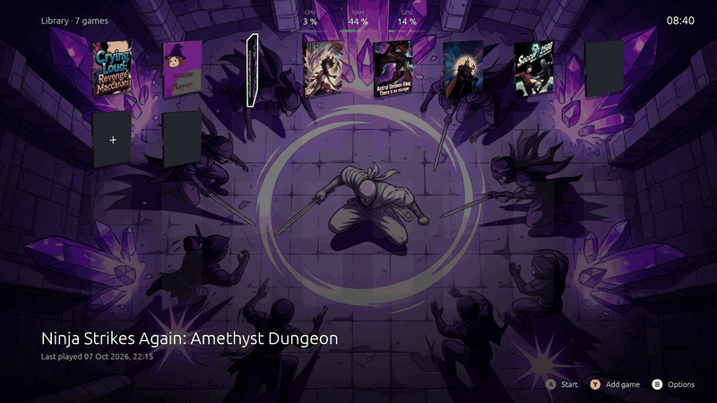
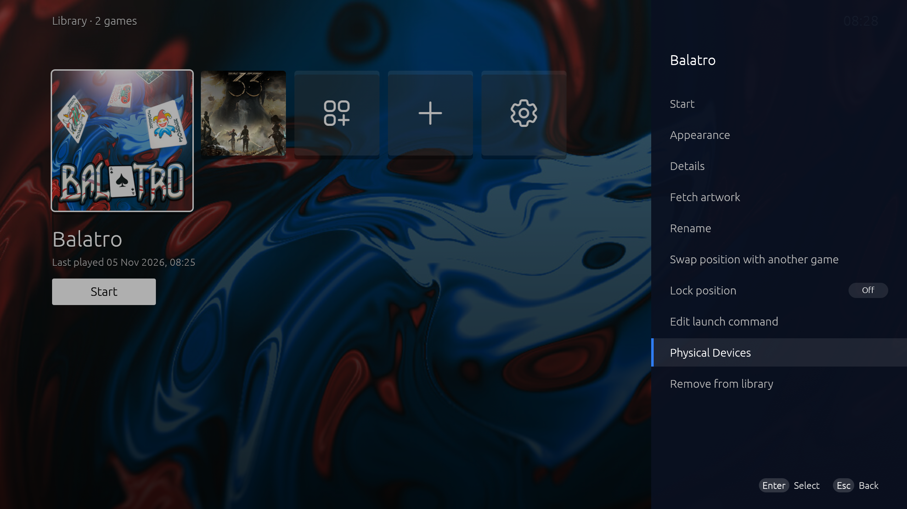
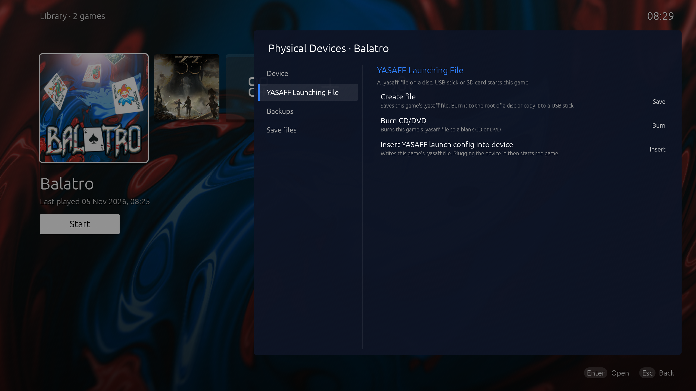
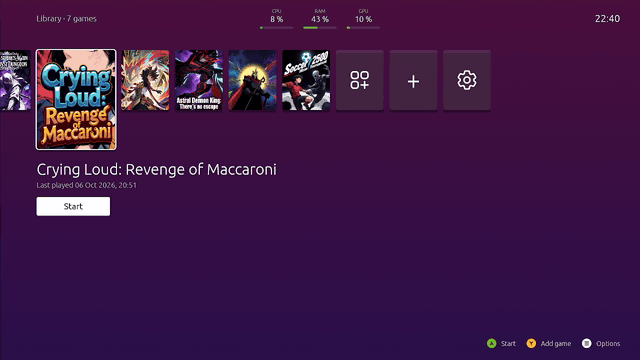
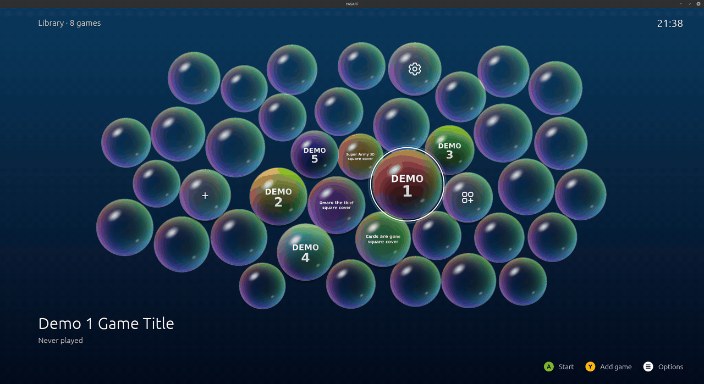
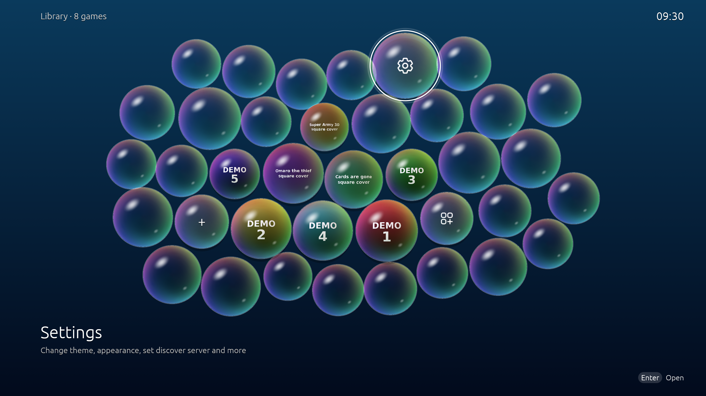
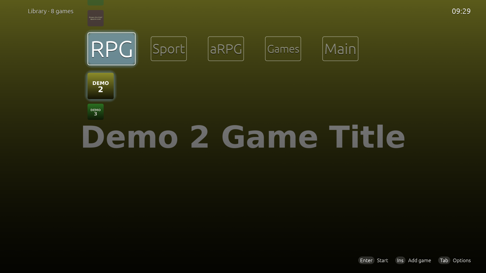

<div align="center">

#  YASAFF Launcher


[](LICENSE)


</div>



**YASAFF Launcher** is a software/layer that tries mimic console experience and allow you makes games
more centered about physical devices:
- Fully customizable console-alike menu
- Dedicated apps available to imitate working in background
- Boot your games from physical devices
- Manage your saves (on physical devices)
- Install application, themes & more from discover servers
(https://github.com/naisyrkdev/YasaffDiscoverServer) (or directly from github [within app])


It runs on Windows and Linux. Mac support on the way.

## Launching games from a physical device

Turn any USB stick, SD card or CD/DVD into a "game cartridge": insert it, and its game starts, like on a console.

**1. Open the game's Physical Devices.** In the library, select the game, press **Menu** (or **Tab**) and choose **Physical Devices**.



**2. Write the launch file to the device.** Go to **YASAFF Launching File** and pick one:

- **Insert YASAFF launch config into device:** choose a plugged-in USB stick or SD card, and YASAFF writes the game's `.yasaff` file onto it. The easiest option.
- **Burn CD/DVD:** burns the `.yasaff` file to a blank CD or DVD.
- **Create file:** saves the `.yasaff` file anywhere, so you can copy it to the root of a device or burn it yourself.



**3. Plug it in.** With YASAFF running, insert the disc, USB stick or SD card and the game starts.

For USB sticks and SD cards, make sure **USB stick and SD card support** is on in **Settings → Physical Devices**. There you also choose what happens when a device is inserted (*Start the game*, *Ask first* or *Do nothing*). Saves can travel with the device too, see [Saves](#saves). More details in [Discs, USB sticks and SD cards](#discs-usb-sticks-and-sd-cards).

## Roadmap
- Create an open-source 3D printable model for case that will have slot for both USB Stick (game data, installers) and CD/DVD (only for game launching) and second - double USB Stick (game data; launcher + managing saves). It's all about data retention on USB Sticks (flash).
- NFC - support on the way. 

## FAQ
### Is this project AI-generated ("vibe-coded")?

Yes, mostly, indeed.

### Is there commnity server?

Yea, created here: https://discord.gg/fMRpS6Jmr

## Details
- [Features](#features)
- [Installing and building](#installing-and-building)
- [Adding games](#adding-games)
- [Controls](#controls)
- [Apps and games in the background](#apps-and-games-in-the-background)
- [Game options](#game-options)
- [Customization](#customization)
- [Discs, USB sticks and SD cards](#discs-usb-sticks-and-sd-cards)
- [Saves](#saves)
- [YASAFF Discover, apps and addons](#yasaff-discover-apps-and-addons)
- [Profiles](#profiles)
- [Settings overview](#settings-overview)
- [Data folders](#data-folders)
- [Logs](#logs)


## Support 
<a href='https://ko-fi.com/T3T7280TZN' target='_blank'></a>

## Features

- A fullscreen library you use with a controller. Keyboard and mouse work too.
- Finds installed games in **Steam**, **Heroic Games Launcher** and desktop shortcuts, and uses their artwork.
- Starts games directly or through their store. YASAFF follows the game process, so it knows when the game is running and comes back when the game closes.
- Two layouts (**Row view** and **Grid view**), a **Bubbles** theme, and eight tile styles, from flat cards to 3D boxes, opening cases, spinning discs and CRT screens.
- **Custom themes** that bring their own code and draw the home screen their own way, with their own options in Settings.
- Themes with their own backgrounds, bars, button looks, icons, fonts and sounds. You can export and import them.
- **Physical games:** insert a disc, USB stick or SD card that holds a `.yasaff` file and its game starts, like on a console. YASAFF can also burn that file to a CD or DVD.
- Save backups, and save syncing to the USB stick or SD card a game was started from.
- A virtual mouse on the right analog stick and button remapping.
- **YASAFF Discover** for apps, games, themes and addons, and bar widgets you can place on the screen.
- Several profiles, each with its own library and settings.
- Available in English, French, Spanish and Polish.

## Installing and building

**Windows:** run the `YASAFF-Setup-<version>.exe` installer. It installs for the current user and doesn't need admin rights. A portable `YASAFF-<version>-portable-win64.zip` is also available: unzip it anywhere and run `yasaff.exe`, no installation needed. The first time it runs, it asks whether to keep your library, settings and saves in your Windows user account (reusing them if YASAFF is already installed there) or inside the unzipped folder itself, so the whole thing stays self-contained (for example on a USB stick); it remembers the answer after that.

**Linux:** download `yasaff.AppImage`, make it executable (`chmod +x yasaff.AppImage`) and run it. On Debian, Ubuntu and Mint you can instead install `yasaff_<version>_amd64.deb` (`sudo apt install ./yasaff_<version>_amd64.deb`), which adds YASAFF to the applications menu.

The Windows installer, the portable .zip and the AppImage come with everything YASAFF uses: **ffmpeg** for preview and idle videos, and on Linux **xorriso** for **Burn to CD/DVD…**. You don't have to install anything else. The .deb installs ffmpeg and xorriso from your distribution instead.

**From source** (Rust, edition 2024):

```sh
cargo build --release
./target/release/yasaff               # starts fullscreen; turn it off in Settings → General
```

A build from source uses `ffmpeg` and `xorriso` from your system, if they're installed. Without them, videos don't play and discs can't be burned.

To build the Windows installer, run `installer/build-installer.ps1`. It needs Inno Setup 6.3 or newer, downloads ffmpeg, and writes `target/installer/YASAFF-Setup-<version>.exe`.

To build the Windows portable .zip, run `installer/build-portable.ps1`. It downloads ffmpeg and writes `target/portable/YASAFF-<version>-portable-win64.zip`.

To build the AppImage, run `installer/build-appimage.sh`. It needs `cargo-appimage`, `appimagetool`, `curl`, a C compiler and `make`. It downloads ffmpeg, builds xorriso, and writes `target/appimage/yasaff.AppImage`.

To build the .deb, run `installer/build-deb.sh`. It needs `dpkg-deb` and `dpkg-shlibdeps` (package `dpkg-dev`) and writes `target/deb/yasaff_<version>_<arch>.deb`. Build it on the oldest distribution you want to support: the package depends on that distribution's glibc and library versions.

Command-line flags:

| Flag | Effect |
|------|--------|
| `--fullscreen` | Start fullscreen, whatever the setting says |
| `--disc <folder>` | Treat `<folder>` as an inserted disc and read its `.yasaff` file |

## Adding games

A new profile starts empty. On its first start YASAFF asks which look to use, **Default** or **Bubbles**, then offers the repositories listed in [initial_content/initial_install_repos.txt](initial_content/initial_install_repos.txt), one at a time: "Do you want to download this repo?" with its type, `owner/name` and description. **Download** installs it as with **Install from GitHub**, and **Skip** moves on. See [initial_content/README.md](initial_content/README.md) for the format of the list.

Open the **Add game** tile, or press **Y** / **Insert**. From there you can:

- **Scan for games:** looks in Steam, Heroic and game shortcuts. Tick the games you want and import them. YASAFF also looks for images of the ticked games on this computer.
- **Add a file:** a game executable, a script, or a `.desktop` / shortcut file.
- **Add a command or URL:** for example `steam://rungameid/...` or any command line.
- **Import an application from file:** a YASAFF app or game package (`.zip`).
- **Install from GitHub:** a YASAFF app, addon or theme from a GitHub repository (see below).

Games installed from YASAFF Discover are added to the library automatically.

## Controls

These are the default bindings. You can remap every controller button in **Settings → Controller**.

| Action | Controller | Keyboard |
|--------|------------|----------|
| Move | D-pad / left stick | Arrow keys |
| Select / confirm | A | Enter, Space |
| Back / cancel | B | Esc, Backspace |
| Delete | X | |
| Add / extra (Add game on the home screen) | Y | Insert |
| Options (game menu) | Menu | Tab |
| Toggle fullscreen | View | F11 |
| Bring YASAFF to front | Guide | |
| Mouse click / right-click (virtual mouse) | RT or R3 / LT | |

While a game or app is running, press **Guide** to come back to YASAFF. See [Apps and games in the background](#apps-and-games-in-the-background).

## Apps and games in the background



You don't have to close a game or app to get back to YASAFF. Press **Guide** and it stays open in the background while YASAFF comes to the front. A music player, for example, keeps playing.

- The running entry shows **Running** under its name in the library.
- Select it and press **A**. Its options show **Switch to game** / **Switch to app** instead of **Start**. It opens again where you left it, fullscreen or over YASAFF's window, just as it was.
- To end it from YASAFF, use **Close game** / **Close application** in its options.
- When the game or app quits on its own, YASAFF comes back to the front by itself.
- Only one app from YASAFF Discover can run at a time.

## Game options

Press **Menu** (or **Tab**) on a game to open its options:

- **Start**, **Close game** / **Close application**, and **Update** for store apps.
- **Appearance**: one section per tile style (square cards, game covers, the box styles, 3D objects, discs and CRT screens), each with its own cover image and its own size and position. A style without a cover of its own copies the one shown before it when you switch to it. Then the box sides (spine, top, back, side, bottom, booklet, colors), the background, preview and idle videos, the picture a custom theme asks for (if the current theme asks for one), the title font, and the **Gallery**.
  - Choosing an image asks whether to **Import new** or **Use from gallery**, so images the game already has can be reused.
  - The **Gallery** lists every image the game has, imported or fetched, and where each one is used. Images nothing uses can be deleted there.
  - **Settings → General → Keep every image in gallery, manage it manually** is on by default. Turn it off and a new image deletes the one it replaces, unless another tile style still shows it.
- **Details**: the game's categories. A game can be in several; one of them is its main category.
- **Fetch artwork**, **Rename**, **Edit launch command**.
- **Swap position with another game** (or **Swap with other bubble**), and **Lock position**, an On/Off switch that keeps the game in its slot.
- **Physical Devices**: the game's launch file and save backups. See [Discs, USB sticks and SD cards](#discs-usb-sticks-and-sd-cards) and [Saves](#saves).
- **Remove from library**: removes only the library entry and its images. The game files stay.

## Customization



Everything about the look is part of a **theme**. Open **Settings → Theme** to switch themes, create one (it starts as a copy of the current one), rename, export, import or delete it. A theme is shared as a **theme package**: a `.zip` with `themeSettings.json`, its `images/` folder and, for a custom theme, its code (`theme.wasm`). Export writes one, and import installs one. The built-in **Bubbles** theme can't be deleted. Bubbles and custom themes offer fewer of the built-in options.

A **custom theme** draws the home screen with its own code, a WebAssembly module that YASAFF runs sandboxed. The theme decides the layout, the navigation and the animation, and declares its own options, pictures and a per-game picture, which show up in Settings like YASAFF's own. YASAFF ships none: you install them from a package or from Discover. [YasaffDoubleAxisTheme](../YasaffDoubleAxisTheme/) is the example of making one, and [docs/THEMES.md](docs/THEMES.md) describes how.

**Themes** (click a picture to open it full size)

*Bubbles* is built in. *Double axis* is a custom theme kept in a separate repository, [YasaffDoubleAxisTheme](https://github.com/naisyrkdev/YasaffDoubleAxisTheme). The launcher offers to download it during first-time setup, or you can install it manually from that repository.

| Theme | Description | View |
| --- | --- | --- |
| **Bubbles** (built in) | Games float as bubbles of different sizes, with empty bubbles filling the screen, a preview video and a swap sound. | <a href="assets/for_docs/custom_themes/bubbles.png"></a> |
| **Double axis** ([separate repository](https://github.com/naisyrkdev/YasaffDoubleAxisTheme), downloadable during first-time setup) | Double axis menus. Categories run along the top, the games of the selected one below it. | <a href="assets/for_docs/custom_themes/double_axis.png"></a> |

**Categories:** add, rename, reorder and delete them in **Settings → Categories**. Saving a category with an empty name deletes it; its games stay in the library.

**Home screen**

- **Layout:** *Row view* or *Grid view*. Each layout keeps its own setup.
- **Tile style:** *Square cards*, *Game covers*, *3D model boxes*, *3D objects*, *3D discs*, *3D opening cases* or *CRT screens*.
- **Row view:** up to 4 rows, tile size, space between tiles, a bigger selected tile, and the row position (top, middle or bottom).
- **Grid view:** columns, rows per page, spacing, a bigger selected tile and the grid position.

**Tile styles**

- **Boxes and covers:** box shape (three preset sizes or a custom one from 50 to 400 mm), depth, spine label, spine, spine text and top colors. Each game can change them in its options.
- **Discs:** CD, DVD or Blu-ray look, angle, spinning, spin direction (around its center, flipping over, or flat like in a drive) and speed.
- **3D objects:** a game shows its own 3D model (STL, OBJ, PLY, glTF/GLB or 3MF), or its name in 3D letters.
- **CRT screens:** screen size, a CRT filter (scanlines, flicker, darker edges), and preview and idle videos.
- **Bubbles:** bubble size, random size difference, empty bubbles that fill the screen, shuffling, preview video, and a swap sound.
- **Custom themes:** the options the theme declares (sizes, toggles, colors, choices, fonts), a page of pictures (one for each category, and any the theme names), and the per-game picture in each game's **Appearance**.

**Background:** each game's own background art, or a solid color, gradient or image (fill, fit, stretch, repeat, repeat mirrored or center).

**Top and bottom bars:** turn them on or off and set the height and fill: a color (`#rrggbbaa` makes it see-through), a gradient, or an image you can scale, move and rotate.

**Buttons:** use controller images or drawn buttons, choose the shape and colors per button, or use your own image. Button hints follow the controller you use (Xbox or PlayStation), or you can choose one in **Settings → Controller**.

**Tile icons:** use your own SVG icons for the Discover, Add game and Settings tiles.

**Sounds:** a tick when moving between games and a bloop between bubbles. You can use your own WAV, MP3, OGG or FLAC file.

**Fonts:** import TrueType or OpenType fonts (`.ttf`, `.otf`, `.ttc`) and use them for game titles, for all games or per game.

**Shortcuts:** give **Discover** and **Add game** a controller button, then show them as a library tile or in the top or bottom bar.

**Game order:** put the last played games first, or turn on a static order so games only move when you swap them. You can also fix a single game to its slot.

## Discs, USB sticks and SD cards

A **disc file** is a small JSON file with the `.yasaff` extension that tells YASAFF which game to start:

```json
{
  "yasaff": "disc",
  "version": 1,
  "id": "<YASAFF game id>",
  "ids": { "steam": "{steam_id}", "gog": "{gog_id}" },
  "name": "Kombo Breiker: Breaking Inside"
}
```

`id` or at least one entry in `ids` is required. When the `id` matches, that game starts. Otherwise YASAFF looks for the store IDs and lets you choose when more than one game matches.

- In a game's **Physical Devices**, under **YASAFF Launching File**, **Create file** writes the file and **Burn CD/DVD** burns it to a disc.
- In **Settings → Physical Devices** you choose what happens **when a disc is inserted** (*Start the game*, *Ask first* or *Do nothing*). You can also check the drive when YASAFF starts and turn on USB stick and SD card support, so those work like discs.
- On the same page you can pick a plugged-in device and **Insert YASAFF launch config into device**. After that, plugging the device in starts the game.

## Saves

- The **Backups** section of a game's **Physical Devices** holds everything about its saves: **Change save folder** tells YASAFF where the game keeps them, **Open save folder** shows them, **Create backup catalog in device** makes `YasaffSaves/<game>/` on the picked device, and **Backup current saves to device** zips the save folder into a timestamped backup, with the folder picker opening on that device.
- **Saves on a launch device:** turn on **Keep saves on the launch device** in **Settings → Physical Devices**, and **Keep saves on device that was used to launch this game** in the game's Physical Devices. When the game closes, its saves are copied to `YasaffSaves/<game>/` on the USB stick or SD card it was started from. **Disaster Recovery Count** sets how many older timestamped copies are kept. You can track the whole save folder, or only some files and folders.

Each copy is written to a temporary folder first and then renamed, so pulling the device out never leaves a half-written save.

## YASAFF Discover, apps and addons

The **Discover** tile lists apps, games, themes and addons from a YASAFF Discover Server ([YasaffDiscoverfServer](https://github.com/naisyrkdev/YasaffDiscoverServer)), where you install and update them. Add the store address in **Settings → YASAFF Discover**. You can add several stores and switch between them.

- **Apps** are separate programs that YASAFF starts and holds inside its own window. Press Guide to come back to YASAFF while they keep running.
- **Addons** are bar widgets, for example device info or a clock. Manage them in **Settings → Addons → Addons Manager…** and show each one in the top bar, the bottom bar or anywhere on the screen, at 50–300 % size.

**Installed** is the last Discover tab, and the one Discover opens on when no store is set up. It lists every app and addon you have, wherever it came from, with a tag for its source: the store, **GitHub**, **File** (imported from a `.zip`), **Built in** (came with YASAFF) or **Other store**. In the store's own tabs, apps you installed from somewhere else carry the same tag, in yellow, and say they're not from this store.

The first row of **Installed**, **Install from GitHub…**, works with or without a store. Type the repository as `owner/name` (or paste its github.com address). YASAFF downloads the `.zip` attached to the repository's latest release, the one whose name has `windows`, `linux` or `macos` in it when there are several. GitHub's checksum is checked when it has one. A release without a `.zip` falls back to its source archive, and a repository without a release to its default branch's source; both only work for packages that need no build. A package with `themeSettings.json` instead of `yasaffConfig.json` is added as a new theme; pick it in **Settings → Theme**. To update, press **Y** on the app in **Installed**: the prompt comes filled in with its repository. Without signing in, GitHub allows 60 requests an hour.

To make your own app, game package or addon, see [docs/YASAFF_application_guide.md](docs/YASAFF_application_guide.md).

## Profiles

Each profile has its own library, settings, themes, images and apps. In **Settings → Profiles** you can switch, rename, create, reset, export (one `.zip`, without store API keys) or import profiles. **Reset application** deletes every profile and all data, like a fresh install.

## Settings overview

| Section | Options |
|---------|---------|
| General | Start in fullscreen, run at system startup, language |
| Game order | Last played games first, static order |
| Profiles | Change, rename, create, export, import, reset |
| Power options | Reset application |
| YASAFF Discover | Active store, address, test connection, add or remove stores |
| Steam / Heroic | Launch games through the store, start the store in the background with YASAFF, custom launch command (auto-detected by default) |
| Physical Devices | When a disc is inserted, check the drive at startup, USB stick and SD card support, keep saves on the launch device |
| Mouse | Virtual mouse on the right stick, speed, custom cursor and cursor size |
| Controller | Button hints, swap A/B (for Nintendo Switch habits), remap every button, Discover and Add game shortcuts, reset bindings |
| Fonts | Game title font, import and manage fonts |
| Theme | Everything in [Customization](#customization) |
| Addons | Addons Manager |
| About | Version, source code, YASAFF Discover Server |

Settings are saved in `userSettings.json` in the profile folder.

## Data folders

| | Linux | Windows |
|-|-------|---------|
| YASAFF data | `~/.local/share/yasaff/` | `%APPDATA%\yasaff\data\` |
| A profile | `…/profiles/<profile>/` | `…\profiles\<profile>\` |

A profile folder holds the library, settings, themes, `apps/`, `appdata/` (data of installed apps, kept on uninstall), `addons/`, and the `apps_installation_packs/` and `addons_installation_packs/` folders that the import dialogs open in.

## Logs

YASAFF writes a log to `<YASAFF data>/logs/yasaff.log` (the previous run's log is kept as `yasaff.old.log` once it grows past 2 MB):

- Linux: `~/.local/share/yasaff/logs/`
- Windows: `%APPDATA%\yasaff\data\logs\`

Attach it when reporting a problem.

## License

See [LICENSE](LICENSE).
